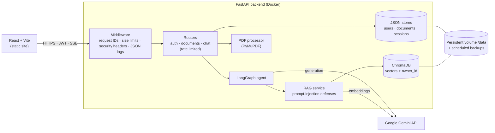
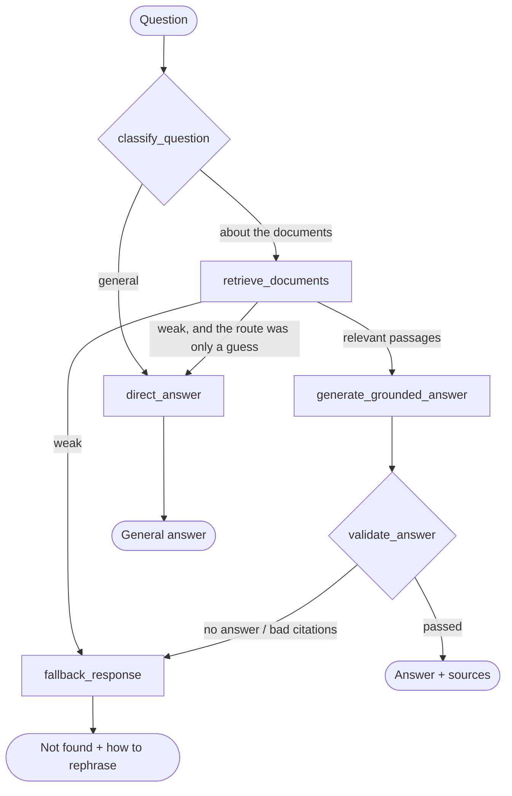

# AI Q&A Assistant

Ask questions about your own PDFs and get answers grounded in the documents — with the file name and page number for every claim. An agent decides per question whether to search your documents or answer from general knowledge, and answers stream in as they are generated.

**Live demo:** _add your URL here_ · **Demo video:** _add your link here_ · Use **"Try the demo account"** on the login page — no sign-up needed.

| Chat with citations | Agentic routing | Login |
|---|---|---|
|  |  |  |

## Features

- **Document-grounded answers (RAG)** — PDFs are split into overlapping chunks, embedded with Gemini, and stored in ChromaDB. Answers cite their sources as `[1]`, shown below the answer as *handbook.pdf, page 4* with the matching excerpt.
- **Agentic routing (LangGraph)** — each question goes through a graph that classifies it (rules first, then an LLM intent classifier), retrieves, generates, and validates the answer, falling back gracefully when retrieval is weak.
- **Honest fallbacks** — a similarity threshold means unrelated questions get *"I couldn't find that information in the uploaded documents"* instead of a made-up answer. Answers are clearly labelled *From your documents*, *General knowledge*, or *Not found*.
- **Streaming** — tokens arrive over Server-Sent Events, with live status ("Searching your documents…"), a Stop button, and partial answers preserved.
- **Conversation memory** — follow-up questions ("and how many of those carry over?") work because history is sent with each turn and stored per session.
- **Multi-user and private** — accounts with hashed passwords; every document, vector and conversation is scoped to its owner.

## Architecture



### How a question is answered



Routing rules run before any LLM call: the user's mode toggle → a selected document → no documents uploaded → the question mentions "the PDF", "page 3" or a filename → an LLM intent classifier (structured JSON output) → a default that tries retrieval and falls back to a direct answer.

## Tech stack

| Layer | Tools |
|---|---|
| Frontend | React 19, Vite, plain CSS (light/dark), `fetch` + SSE stream parsing |
| API | FastAPI, Pydantic v2, Uvicorn |
| AI | Google Gemini (`google-genai`): generation, structured output, `gemini-embedding-001` (768-dim) |
| Retrieval | ChromaDB (persistent, cosine similarity), custom chunker |
| Agent | LangGraph state graph |
| PDFs | PyMuPDF |
| Auth | JWT (PyJWT), Argon2id password hashing (pwdlib) |
| Ops | Docker, Render Blueprint, structured JSON logging, pytest |

## Security and production readiness

| Concern | What's implemented |
|---|---|
| **Authentication** | Email + password accounts, Argon2id hashes, signed JWTs with expiry. Login failures take the same time and return the same message whether or not the email exists. |
| **Access control** | Every document, vector chunk and session carries an `owner_id`. Vector search is filtered by owner inside ChromaDB. Another user's resources return **404**, not 403, so ids can't be probed. |
| **Secrets** | Only read from environment variables; `.env` is git- and docker-ignored; `JWT_SECRET` is mandatory in production; errors never return stack traces or internal messages. |
| **Upload limits** | Content-Length checked before the body is read (413), 10 MB / 500 pages, PDF signature check, PyMuPDF parse, encrypted and image-only PDFs rejected, 20 documents per user. Files are stored under server-generated UUIDs — user filenames never touch the filesystem. |
| **Rate limiting** | Sliding window: chat 10/min per user, uploads 10/hour per user, login/register 10/min per IP. Responses include `Retry-After`. |
| **Timeouts** | 60 s per Gemini HTTP call, 120 s per chat turn; clients that disconnect cancel generation. |
| **Prompt injection** | Retrieved text is wrapped in `<document_excerpt>` delimiters (and can't close them), known injection phrases are redacted and logged, the system prompt ranks excerpts as untrusted data, answers citing non-existent excerpts are rejected, and the UI renders answers as plain text (no HTML, links or images). |
| **Logging** | One JSON line per request with `request_id`, path, status and latency; `X-Request-ID` is returned to the client; security events (`login_failed`, `prompt_injection_redacted`) are logged. Question text is not logged. |
| **Storage and backups** | All state lives under `DATA_DIR` on a persistent volume. A scheduler writes `backup-*.tar.gz` every 24 h (SQLite copied with the online-backup API) and keeps the newest 7. |

Known limits: the rate limiter and JSON stores are in-process, so the API runs as a single instance. Scaling out would move them to Redis and Postgres.

## Run locally

Prerequisites: Python 3.10+, Node 20+, a [Gemini API key](https://aistudio.google.com/apikey).

```bash
# Backend
python -m venv .venv
.venv\Scripts\activate            # macOS/Linux: source .venv/bin/activate
pip install -r requirements-dev.txt
cp .env.example .env              # then set GEMINI_API_KEY
uvicorn app.main:app --reload     # http://127.0.0.1:8000/docs

# Frontend (second terminal)
cd frontend
npm install
npm run dev                       # http://localhost:5173
```

Every setting is documented in [`.env.example`](.env.example).

## Tests

```bash
pytest
```

26 tests cover authentication, cross-user isolation (API, vector search, sessions), rate limits, upload validation, prompt-injection defenses and agent routing. They use fake embeddings and a stubbed LLM, so they need no API key and make no network calls.

## Docker

```bash
# needs GEMINI_API_KEY and JWT_SECRET in .env
docker compose up --build         # API on http://localhost:8000, data in the app-data volume
```

The image runs as a non-root user, has a health check, and keeps all state under `/data`.

## Deployment

[`render.yaml`](render.yaml) deploys the API (Docker + 1 GB persistent disk) and the frontend (static site) in one step. See **[docs/DEPLOYMENT.md](docs/DEPLOYMENT.md)** for the full walkthrough, including backups and restore.

## API

Interactive docs at `/docs` (use **Authorize** to log in).

| Method | Endpoint | Purpose |
|---|---|---|
| POST | `/api/auth/register`, `/api/auth/login` | Create an account / get a token |
| GET | `/api/auth/me` | Current user |
| POST | `/api/documents/upload` | Upload, validate, extract and index a PDF |
| GET / DELETE | `/api/documents`, `/api/documents/{id}` | List, inspect, delete your documents |
| POST | `/api/chat/stream` | Ask a question (SSE: `status`, `route`, `delta`, `done`, `error`) |
| GET / DELETE | `/api/chat/sessions/{id}` | Conversation history |
| GET | `/health` | Health check |

## Project structure

```
app/
  main.py               app setup, middleware, lifespan (demo user, backups)
  config.py             all settings (env vars)
  logging_config.py     JSON logging + request ids
  auth/                 password hashing, JWT, auth + rate-limit dependencies
  agent/                LangGraph: state, classifier, nodes, graph
  routers/              auth, documents, chat (SSE)
  services/             PDF, chunking, embeddings, ChromaDB, RAG, prompt safety,
                        chat orchestration, stores, rate limiter, backups
frontend/src/           React app (auth screen, chat, documents panel, SSE client)
tests/                  pytest suite
Dockerfile · docker-compose.yml · render.yaml
```
